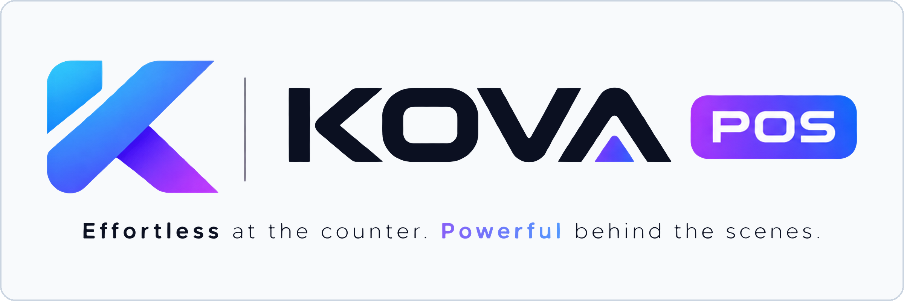
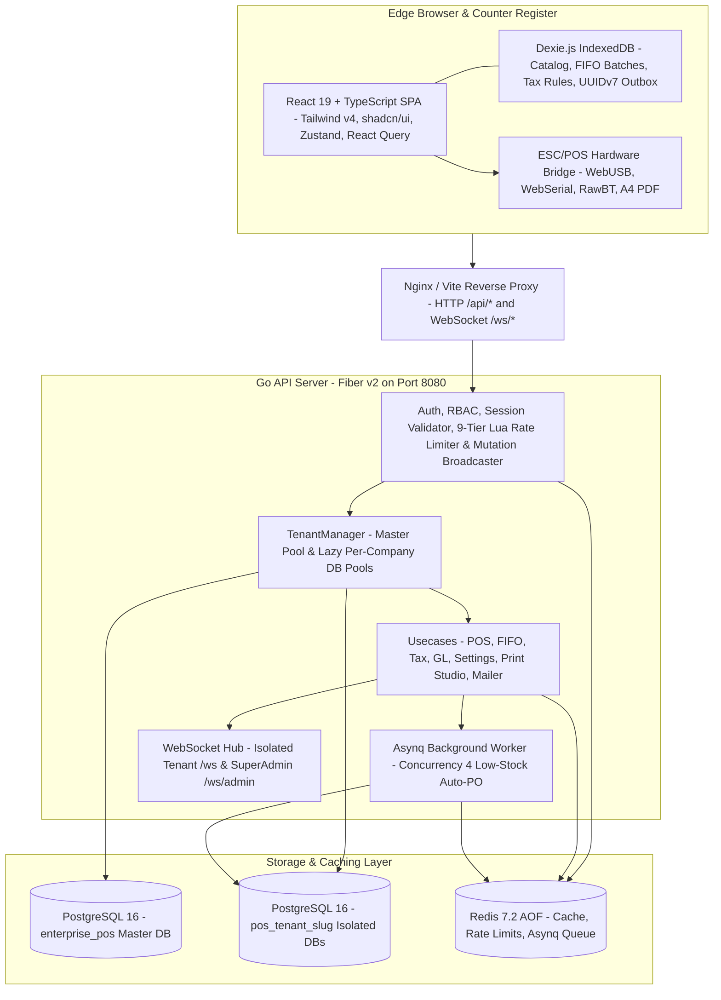
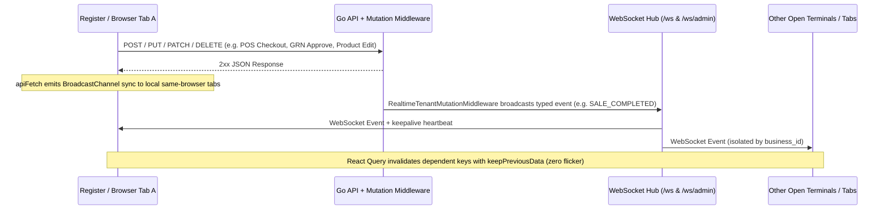
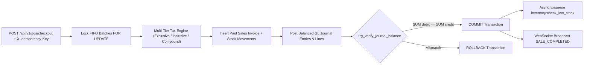

<p align="center">
  <picture>
    <source media="(prefers-color-scheme: dark)" srcset="frontend/public/brand/logos/03-kova-pos-dark-background.png" />
    
  </picture>
</p>

<h1 align="center">KOVA POS — System Architecture</h1>

<p align="center">
  <strong>Effortless at the counter. Powerful behind the scenes.</strong><br/>
  Multi-Tenant Clean / Hexagonal Architecture · Database-Per-Company SaaS Isolation · Offline-First Edge POS · Immutable Double-Entry Accounting
</p>

---

## Table of Contents

1. [Executive Summary](#1-executive-summary)
2. [High-Level System Topology](#2-high-level-system-topology)
3. [Database-Per-Company SaaS Isolation](#3-database-per-company-saas-isolation)
4. [Clean Backend Module Boundaries](#4-clean-backend-module-boundaries)
5. [Real-Time Synchronization Architecture](#5-real-time-synchronization-architecture)
6. [6-Level Settings Inheritance Engine](#6-6-level-settings-inheritance-engine)
7. [ACID POS Checkout, FIFO Inventory & Double-Entry GL](#7-acid-pos-checkout-fifo-inventory--double-entry-gl)
8. [Offline-First Edge Register & Print Hardware Bridge](#8-offline-first-edge-register--print-hardware-bridge)
9. [Security, Sessions, Rate Limiting & Email Recovery](#9-security-sessions-rate-limiting--email-recovery)
10. [Deployment Topology & Ports](#10-deployment-topology--ports)

---

## 1. Executive Summary

KOVA POS is engineered to support **specialty cafes**, **multi-variant retail boutiques**, and **high-SKU hardware & service businesses** from a unified codebase while maintaining strict financial, tenant, and operational guarantees:

| Architectural Pillar | How KOVA POS Implements It | Source Reference |
| :--- | :--- | :--- |
| **Tenant & DB Isolation** | Separate physical PostgreSQL 16 database per company (`pos_tenant_<slug>`) + isolated Master Control Plane DB (`enterprise_pos`) | [`backend/internal/infrastructure/tenant/manager.go`](backend/internal/infrastructure/tenant/manager.go) |
| **Precision Financial Math** | PostgreSQL `NUMERIC(19,4)`, `sqlc` overrides to `shopspring/decimal`, string-safe decimal utilities in TypeScript | [`backend/sqlc.yaml`](backend/sqlc.yaml) |
| **Double-Entry Accounting** | Deferred commit trigger `trg_verify_journal_balance` enforces `SUM(debit) = SUM(credit)` inside every `pgx/v5` transaction | [`backend/migrations/000001_init_3nf_schema.up.sql`](backend/migrations/000001_init_3nf_schema.up.sql) |
| **Zero-Refresh Real-Time UI** | Concurrency-safe WebSocket `/ws` & `/ws/admin` hubs + `BroadcastChannel` + React Query live invalidation | [`frontend/src/lib/realtime.ts`](frontend/src/lib/realtime.ts) |
| **Offline Resilience** | IndexedDB (`Dexie.js`) catalog/batch/tax mirror + `UUIDv7` `sync_outbox` with `X-Idempotency-Key` replay | [`frontend/src/lib/dexie-db.ts`](frontend/src/lib/dexie-db.ts) |
| **Configuration Flexibility** | 6-level hierarchical overrides cached in Redis + in-process memory TTL fallback | [`backend/internal/usecase/settings_resolver.go`](backend/internal/usecase/settings_resolver.go) |
| **Security Governance** | Stateful DB/Redis sessions (`user_sessions`, `platform_admin_sessions`), 9-tier Lua rate limiter, RBAC + 6-digit PIN overrides | [`backend/internal/infrastructure/ratelimit/limiter.go`](backend/internal/infrastructure/ratelimit/limiter.go) |

---

## 2. High-Level System Topology



---

## 3. Database-Per-Company SaaS Isolation

KOVA POS separates platform operations from company accounting and POS records at the physical database boundary:

| Scope | Database Name | Token Scope & Middleware | Purpose |
| :--- | :--- | :--- | :--- |
| **Platform Master Control Plane** | `enterprise_pos` | `PLATFORM_ADMIN` via `PlatformAdminMiddleware` | Stores `platform_admins`, `platform_admin_sessions`, `platform_companies` registry, and cross-tenant `audit_logs` |
| **Isolated Company Database** | `pos_tenant_<slug>` | `TENANT` via `TenantAuthMiddleware` | Stores all operational 3NF ERP, POS, Inventory, FIFO, Tax, Print Studio, Customer, Supplier, and GL tables |

### How Request Routing Works
1. A tenant JWT carries `token_scope: "TENANT"`, `business_id`, `company_slug`, and `session_id` (`jti`).
2. [`TenantAuthMiddleware`](backend/internal/delivery/http/middleware/rbac.go) verifies the JWT signature, confirms the tenant slug matches, checks active session state against Redis/PostgreSQL, and resolves the `*tenant.TenantBundle` from [`TenantManager`](backend/internal/infrastructure/tenant/manager.go).
3. Lazy `pgxpool` pools are bounded to `MaxConns = 10` per active tenant database (`MinConns = 0`) so dormant tenants consume zero idle DB connections.
4. `PlatformAdminMiddleware` strictly rejects tenant tokens (`TENANT`), and `TenantAuthMiddleware` strictly rejects platform admin tokens (`PLATFORM_ADMIN`).

---

## 4. Clean Backend Module Boundaries

```text
backend/
├── cmd/api/main.go                       # Composition root: DB, migrations, Redis, Mailer, TenantManager, Fiber, Asynq
├── internal/
│   ├── config/config.go                  # Runtime config + zero-dependency .env loader
│   ├── domain/models.go                  # Core structs, TenantContext, SessionPolicy
│   ├── infrastructure/
│   │   ├── db/migrate.go                 # Master & per-tenant SQL migration runner (000001..000013)
│   │   ├── mailer/mailer.go              # Net/SMTP relay (465 TLS, 587 STARTTLS, 1025 plain)
│   │   ├── ratelimit/limiter.go          # Atomic Redis Lua counter + in-memory fallback
│   │   ├── tenant/manager.go             # Database-per-company pool & usecase bundle router
│   │   └── ws/hub.go                     # Per-connection mutex-serialized Tenant & Admin WebSocket hub
│   ├── repository/sqlc/
│   │   ├── queries/*.sql                 # Source SQL queries
│   │   └── db/*.sql.go                   # Type-safe sqlc generated Go + pgx/v5 bindings
│   ├── usecase/                          # Business logic: auth, pos_checkout, inventory_fifo, tax_engine, accounting_gl, settings_resolver, print_studio, analytics, admin_audit
│   ├── worker/low_stock_worker.go        # Asynq worker drafting Auto-POs & supplier invoices
│   └── delivery/http/                    # Fiber router, REST handlers, security/session handlers, RBAC & rate-limit middlewares
└── migrations/                           # 13 sequential versioned up/down SQL migrations + demo seed
```

---

## 5. Real-Time Synchronization Architecture

Every client stays up to date **without manual page refreshes** via a three-layer invalidation pipeline:



### Key Real-Time Mechanics
- **Global Query Freshness ([`frontend/src/main.tsx`](frontend/src/main.tsx)):** Configured with `staleTime: 10_000`, `refetchOnWindowFocus: true`, `refetchOnReconnect: true`, `refetchOnMount: 'always'`, and `placeholderData: keepPreviousData` so data updates smoothly in place with zero loading-skeleton flash.
- **Same-Browser Echo ([`frontend/src/lib/realtime.ts`](frontend/src/lib/realtime.ts)):** `BroadcastChannel('kova_pos_realtime_sync')` notifies open same-browser tabs immediately after any successful `apiFetch` / `adminApiFetch` mutation.
- **Cross-Terminal WebSockets (`/ws` & `/ws/admin`):** Server middleware broadcasts domain events (`SALE_COMPLETED`, `HELD_BILL_SYNC`, `CATALOG_UPDATED`, `CUSTOMER_UPDATED`, `SUPPLIER_UPDATED`, `INVENTORY_UPDATED`, `LOW_STOCK_ALERT`, `ACCOUNTING_UPDATED`, `TAX_UPDATED`, `BRANCH_UPDATED`, `RBAC_UPDATED`, `SECURITY_UPDATED`, `SETTINGS_UPDATED`, `PRINT_TEMPLATE_UPDATED`, `SESSION_REVOKED`, and `ADMIN_SYNC`).
- **Connection Resiliency:** Client sockets send 20s `ping` heartbeats alongside 25s server `PING` ticks, reconnect with exponential backoff (1s up to 15s), and display real-time `Live` status indicators in `TopHeader`, `TerminalTopBar`, and `AdminPortalApp`.

---

## 6. 6-Level Settings Inheritance Engine

Configuration values resolve dynamically from broadest system default down to the exact product SKU, allowing granular branch or register customization without duplicating business setup:

`System Default (Priority 6)` -> `Business (Priority 5)` -> `Branch / Warehouse (Priority 4)` -> `Terminal (Priority 3)` -> `Category (Priority 2)` -> `Product SKU (Priority 1, Highest)`

| Scope Level | Examples of Settings Controlled |
| :--- | :--- |
| **System Default** | Fallback values defined in `setting_definitions` |
| **Business** | Base currency, industry profile (`retail`, `restaurant`, `hardware`, `garage`, `mobile`, `stationery`), session TTL/idle limits, rate-limit RPM |
| **Branch / Warehouse** | Branch tax behavior, negative FIFO stock flag, Auto-PO reorder behavior |
| **Terminal** | Thermal receipt paper width (`58mm`, `76.2mm`, `80mm`), auto cash-drawer kick, offline sync mode |
| **Category** | Category tax group override, discount cap, return policies |
| **Product** | SKU tax exemption, serial/IMEI requirement, fractional quantities |

Resolution reads follow a fast multi-tier cache lookup in [`SettingsResolver`](backend/internal/usecase/settings_resolver.go):
`Redis Cache` -> `In-Memory RWMutex TTL Map` -> `PostgreSQL` -> `WebSocket SETTINGS_UPDATED invalidation`.

---

## 7. ACID POS Checkout, FIFO Inventory & Double-Entry GL

Every financial state change runs inside a single PostgreSQL transaction (`pgx.Tx`):



### Standard Automated Accounting Entries
- **On GRN Approval (`/api/v1/inventory/grns/:id/approve`):**
  - `DEBIT` `1200 Inventory Asset` = Receipt Cost
  - `CREDIT` `2000 Accounts Payable` = Receipt Cost
- **On POS Checkout (`/api/v1/pos/checkout`):**
  - `DEBIT` `1010 Cash` / `1020 Card Clearing` = Grand Total
  - `CREDIT` `4000 Sales Revenue` = Net Sales
  - `CREDIT` `2100 Sales Tax Payable` = Computed Tax
  - `DEBIT` `5000 Cost of Goods Sold` = Weighted FIFO Batch Cost
  - `CREDIT` `1200 Inventory Asset` = Weighted FIFO Batch Cost
- **On Void / Refund:** Posts clean reversing GL lines and restores FIFO batch stock atomically (requires `pos:void_bill` / `pos:refund` permission or a verified `X-Supervisor-Override-Token`).

---

## 8. Offline-First Edge Register & Print Hardware Bridge

- **IndexedDB Store (`enterprise_pos_edge_db`, Dexie.js):** Mirrors `products`, `fifo_batches`, `tax_rules`, `resolved_settings`, `suspended_bills`, `print_templates`, `printer_devices`, and `sync_outbox`.
- **Deterministic Offline Queueing:** When offline, checkouts queue into `sync_outbox` keyed by client-generated `UUIDv7` (`createIdempotencyKeyV7()`) and flush automatically when `window` regains connectivity (`online` event).
- **Hardware & Document Bridge ([`escpos-bridge.ts`](frontend/src/lib/escpos-bridge.ts)):**
  - Generates raw `ESC/POS` binary byte streams for `58mm` (32 cols), `76.2mm` (42 cols), and `80mm` (48 cols) thermal printers, with paper cut (`GS V`) and cash drawer pulse (`ESC p`).
  - Supports **WebUSB**, **WebSerial**, **RawBT**, and vector **A4 PDF** (`jsPDF` + QR code) via the Print Studio designer.

---

## 9. Security, Sessions, Rate Limiting & Email Recovery

### Stateful Sessions & Immediate Revocation
- Tenant staff sessions (`user_sessions`) and Platform Admin sessions (`platform_admin_sessions`) track IP address, browser/OS device labels, idle timeout (`480m` default), absolute lifetime (`24h` default), and max concurrent active sessions (`5` default, automatically evicting the oldest active session).
- Revoking a session in Settings or the Platform Admin Portal updates PostgreSQL/Redis immediately and pushes `SESSION_REVOKED` over WebSockets to terminate the target browser session live.

### Distributed 9-Tier Rate Limiter
Implemented in [`backend/internal/infrastructure/ratelimit/limiter.go`](backend/internal/infrastructure/ratelimit/limiter.go) using atomic Redis `INCR + PEXPIRE` Lua scripts (with thread-safe in-memory fallback and standard `Retry-After` + `X-RateLimit-*` headers):

| Policy | Default Limit | Window | Protected Routes / Scope |
| :--- | :--- | :--- | :--- |
| `auth_login` | `10` | `1m` | Staff login (`/api/v1/auth/login`) per IP + brute-force account lockouts |
| `admin_login` | `8` | `1m` | SuperAdmin login & bootstrap (`/api/v1/admin/login`, `/api/v1/platform/bootstrap`) per IP |
| `auth_recovery` | `5` | `5m` | Password reset emails & resets (`/api/v1/auth/forgot-password`, `/api/v1/auth/reset-password`) per IP & email |
| `pin_verify` | `5` | `5m` | 6-digit supervisor PIN override (`/api/v1/auth/verify-pin`) per Business + User + IP |
| `public_discovery` | `60` | `1m` | Public company portal lookup (`/api/v1/auth/companies`, `/api/v1/auth/branding`) per IP |
| `tenant_api` | `240` | `1m` | General authenticated ERP/settings endpoints (policy-configurable) per Business + User |
| `pos_burst` | `90` | `1m` | POS checkout, held bills & offline outbox sync per Business + User + Terminal |
| `analytics_heavy` | `45` | `1m` | Overview dashboards, enterprise reports & GL queries per Business + User |
| `ws_upgrade` | `20` | `1m` | `/ws` and `/ws/admin` connection upgrades per IP |

### SMTP Password Reset Flow (`000013_password_reset_tokens`)
1. `POST /api/v1/auth/forgot-password` generates a cryptographically random **6-digit numeric OTP** + **32-byte URL reset token**, invalidates prior unused tokens, stores HMAC-SHA256 hashes (15-minute TTL, max 5 guesses), and emails both the OTP and a direct login link via SMTP (`465` TLS, `587` STARTTLS, or local `1025`).
2. `POST /api/v1/auth/reset-password` supports three verified modes: `"email_code"` / `"email_token"`, `"current_password"`, and `"supervisor_pin"`, rotating the bcrypt hash and revoking all active sessions upon completion.

---

## 10. Deployment Topology & Ports

| Service | Host Port | Container / Runtime | Responsibility |
| :--- | :--- | :--- | :--- |
| **Web Frontend** | `5173` *(Docker/Vite)* | `nginx` (`80`) / Vite dev server | Serves React SPA, proxies `/api/` and `/ws*` to Go backend |
| **Go API & WS Server** | `8080` | Static Alpine binary (`/usr/local/bin/pos-api`) | REST API, `/ws`, `/ws/admin`, embedded SQL migrations, Asynq worker |
| **PostgreSQL 16** | `5432` | `postgres:16-alpine` | Master DB (`enterprise_pos`) + dynamically created tenant DBs |
| **Redis 7.2** | `6379` | `redis:7.2-alpine` (`--appendonly yes`) | Settings cache, session cache, Lua rate-limit buckets, Asynq broker |
| **Mailpit** *(optional `dev-mail`)* | `1025` / `8025` | `axllent/mailpit:latest` | Optional local SMTP sink (`1025`) and email preview inbox UI (`8025`) |
